# Campus Student Management System: Day 10 Method-by-Method Architecture & Visual Flowcharts

---

## 🏛️ 1. Real-World Analogy & Simple Explanation of Every File and Folder

Imagine running a **Modern Smart University Campus Office**:

| File / Folder | Real-World Role | Simple Everyday Explanation |
| :--- | :--- | :--- |
| **`pom.xml`** | 📦 **The Construction Blueprint & Supplier Contract** | Tells Maven which tools and workers (Hibernate, PostgreSQL Driver, JSTL) to download and hire, and runs our web server on port `8081`. |
| **`persistence.xml`** | 🔑 **The Master Key & Address Book** | Holds the database login keys (username: `postgres`, password: `password`), the warehouse address (`localhost:5432/campus_db`), and tells Hibernate which entity forms exist. |
| **`JPAUtil.java`** | 🏭 **The Power Station & Connection Dispenser** | Starts the heavy generator (`EntityManagerFactory`) once when the university opens, and quickly vends a lightweight pass (`EntityManager`) to whoever needs to talk to the database. |
| **`Department.java`** | 🏢 **The Academic Department Entity** | Represents real departments (like CSE, ECE, MECH). One department has a roster of many students (`@OneToMany`). |
| **`Student.java`** | 🎓 **The Student Admission Profile** | Represents a student with name, age, and an official badge linking them to their department (`@ManyToOne` with `@JoinColumn(name="department_id")`). |
| **`DepartmentJPADAO.java`** | 📁 **Department Filing Cabinet Clerk** | Directly accesses department records (fetches all departments for dropdown menus, finds department by ID or name). |
| **`StudentJPADAO.java`** | 📁 **Student Records Vault Clerk** | The only worker who directly writes, updates, deletes, and searches student records using Hibernate and JPQL queries. |
| **`StudentService.java`** | 👔 **The Academic Dean / Coordinator** | The manager who sits between the front office (Servlets) and the file clerks (DAOs). Validates business logic and coordinates between student records and departments. |
| **`StudentServlet.java`** | 🛎️ **The Reception Desk (Traffic Controller)** | Receives visitors' requests from the browser, inspects their ticket (`action`), asks the Dean (`StudentService`) to do the work, and sends visitors to the right office room (`student.jsp` or `update-student.jsp`). |
| **`student.jsp`** | 📋 **The Main Campus Hub Display Board** | The big interactive screen where users can see the student list, pick a department from a dropdown to add a student, or filter students by department. |
| **`update-student.jsp`** | ✏️ **The Student Profile Edit Form** | The individual student form pre-filled with the student's current information, letting the user change their name, age, or department. |
| **`student.html`** | 📄 **The Fast New Admission Counter** | A quick standalone HTML page with an add-student form for rapid data entry. |
| **`index.html`** | 🚪 **The Campus Main Entrance** | The welcome doorway with clean navigation links to the Students Hub and Add Form. |

---

## 🗺️ 2. High-Level System Architecture

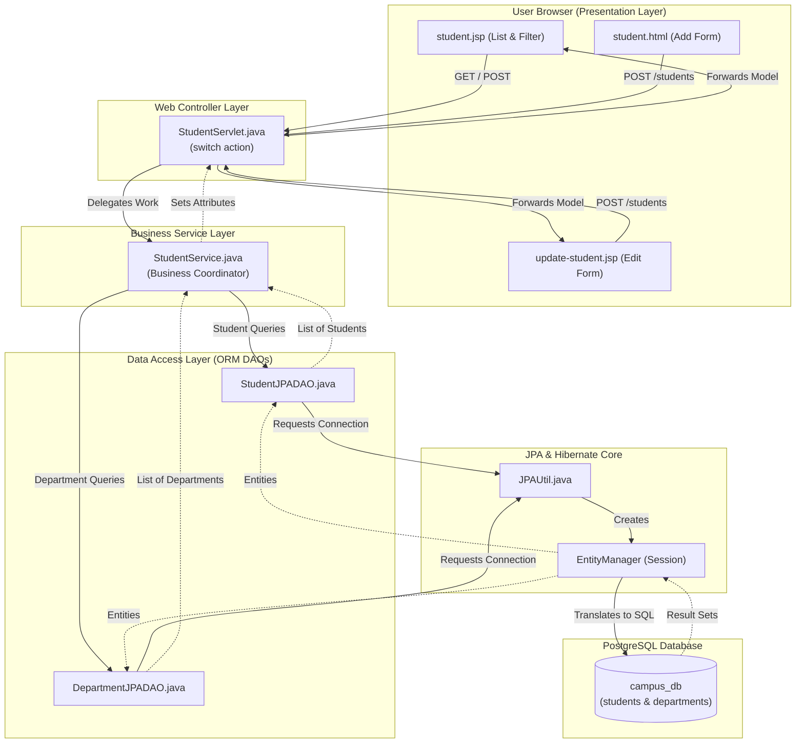

---

## 🏭 3. `JPAUtil.java` Method Flowcharts

### 3.1 `getEntityManager()`
* **Real-World Use Case:** A student walks in to update their profile. The clerk needs an active session stamp (`EntityManager`) to access the database vault.

```mermaid
flowchart TD
    Start([Call JPAUtil.getEntityManager]) --> CheckFactory{Is factory initialized?}
    CheckFactory -->|Yes| Vend["factory.createEntityManager()"]
    CheckFactory -->|No (First Call)| InitFactory["Persistence.createEntityManagerFactory('campusPU')<br/>Reads persistence.xml, builds pool"]
    InitFactory --> Vend
    Vend --> ReturnEM([Return active EntityManager])
```

### 3.2 `close()`
* **Real-World Use Case:** End of the semester or application shutdown. Close all database pools cleanly to prevent memory and connection leaks.

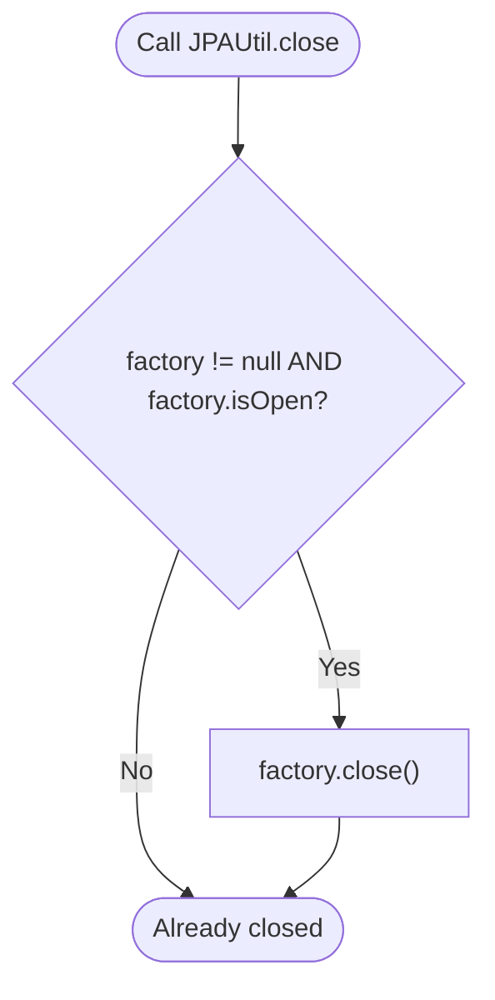

---

## 📁 4. `DepartmentJPADAO.java` Method Flowcharts

### 4.1 `getAllDepartments()`
* **Real-World Use Case:** Populating the `<select>` dropdown in forms so users can pick from `"CSE"`, `"ECE"`, `"EEE"`, `"MECH"`, `"CIVIL"`.

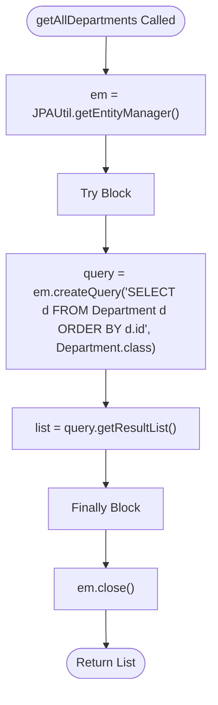

### 4.2 `getDepartmentById(int id)`
* **Real-World Use Case:** When a student form is submitted with `departmentId=2`, fetch the full `Department` entity (ECE) to link to the `Student`.

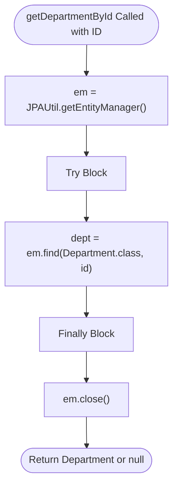

### 4.3 `getDepartmentByName(String name)`
* **Real-World Use Case:** Legacy support: When an old form submits `"CSE"` as a string, find the matching department record without error.

```mermaid
flowchart TD
    Start([getDepartmentByName Called with Name]) --> GetEM["em = JPAUtil.getEntityManager()"]
    GetEM --> TryBlock[Try Block]
    TryBlock --> JPQL["em.createQuery('SELECT d FROM Department d WHERE LOWER(d.name) = LOWER(:name)', Department.class)"]
    JPQL --> Bind["query.setParameter('name', name.trim())"]
    Bind --> Exec["list = query.getResultList()"]
    Exec --> CheckEmpty{list.isEmpty()?}
    CheckEmpty -->|Yes| SetNull["result = null"]
    CheckEmpty -->|No| SetFirst["result = list.get(0)"]
    SetNull --> FinallyBlock[Finally Block]
    SetFirst --> FinallyBlock
    FinallyBlock --> CloseEM["em.close()"]
    CloseEM --> ReturnResult([Return Department or null])
```

### 4.4 `addDepartment(Department department)`
* **Real-World Use Case:** Admin creates a new department (e.g. "Data Science") in the database.

```mermaid
flowchart TD
    Start([addDepartment Called]) --> GetEM["em = JPAUtil.getEntityManager()"]
    GetEM --> GetTx["tx = em.getTransaction()"]
    GetTx --> TryBlock[Try Block]
    TryBlock --> Begin["tx.begin()"]
    Begin --> Persist["em.persist(department)"]
    Persist --> Commit["tx.commit()"]
    Commit --> FinallyBlock[Finally Block]

    TryBlock -. Error .-> CatchBlock[Catch Exception]
    CatchBlock --> CheckTx{tx.isActive()?}
    CheckTx -->|Yes| Rollback["tx.rollback()"]
    CheckTx -->|No| LogErr["e.printStackTrace()"]
    Rollback --> LogErr
    LogErr --> FinallyBlock

    FinallyBlock --> CloseEM["em.close()"]
    CloseEM --> End([Done])
```

---

## 📁 5. `StudentJPADAO.java` Method Flowcharts

### 5.1 `addStudent(Student student)` — Inserting New Entity
* **Real-World Use Case:** A newly admitted student submits their enrollment form.

```mermaid
flowchart TD
    Start([addStudent Called with Student]) --> GetEM["em = JPAUtil.getEntityManager()"]
    GetEM --> GetTx["tx = em.getTransaction()"]
    GetTx --> TryBlock[Try Block]
    TryBlock --> Begin["tx.begin()"]
    Begin --> Persist["em.persist(student)"]
    Persist --> Commit["tx.commit()"]
    Commit --> FinallyBlock[Finally Block]

    TryBlock -. Error Occurs .-> CatchBlock[Catch Exception]
    CatchBlock --> CheckActive{tx.isActive()?}
    CheckActive -->|Yes| Rollback["tx.rollback()"]
    CheckActive -->|No| LogErr["e.printStackTrace()"]
    Rollback --> LogErr
    LogErr --> FinallyBlock

    FinallyBlock --> CloseEM["em.close()"]
    CloseEM --> Done([Student Saved to Database])
```

### 5.2 `getAllStudents()` — Listing All Records
* **Real-World Use Case:** Opening `/students` to show the master student roster table.

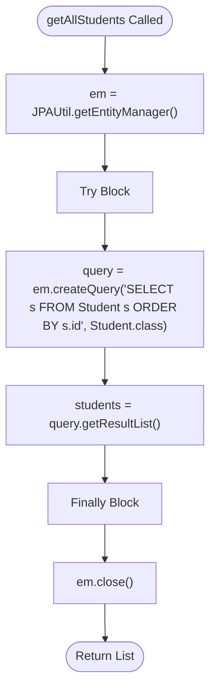

### 5.3 `getStudentById(int id)` — Finding Single Student
* **Real-World Use Case:** Clicking **Edit** next to student #3 loads their existing profile into the edit form.

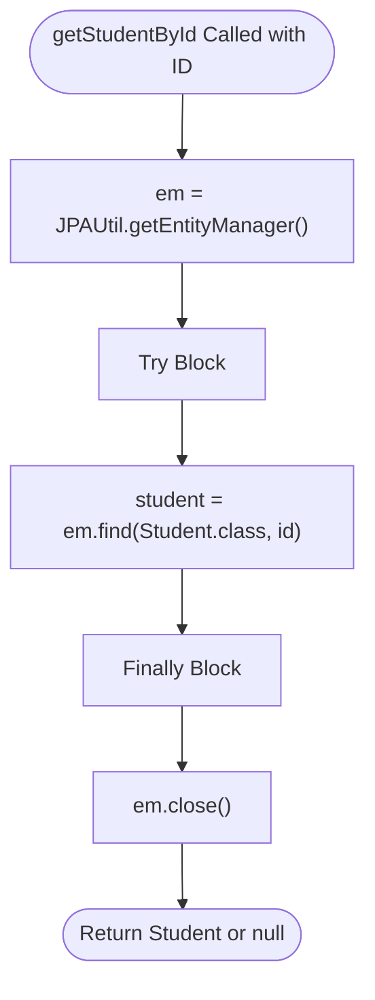

### 5.4 `updateStudent(Student student)` — Updating Changes
* **Real-World Use Case:** Changing a student's age from 21 to 22 or switching their department from CSE to ECE.

```mermaid
flowchart TD
    Start([updateStudent Called with Modified Student]) --> GetEM["em = JPAUtil.getEntityManager()"]
    GetEM --> GetTx["tx = em.getTransaction()"]
    GetTx --> TryBlock[Try Block]
    TryBlock --> Begin["tx.begin()"]
    Begin --> Merge["em.merge(student)"]
    Merge --> Commit["tx.commit()"]
    Commit --> FinallyBlock[Finally Block]

    TryBlock -. Error Occurs .-> CatchBlock[Catch Exception]
    CatchBlock --> CheckActive{tx.isActive()?}
    CheckActive -->|Yes| Rollback["tx.rollback()"]
    CheckActive -->|No| LogErr["e.printStackTrace()"]
    Rollback --> LogErr
    LogErr --> FinallyBlock

    FinallyBlock --> CloseEM["em.close()"]
    CloseEM --> Done([Changes Saved])
```

### 5.5 `deleteStudent(int id)` — Deleting a Record
* **Real-World Use Case:** Student graduated or transferred out; delete button removes their record from PostgreSQL.

```mermaid
flowchart TD
    Start([deleteStudent Called with ID]) --> GetEM["em = JPAUtil.getEntityManager()"]
    GetEM --> GetTx["tx = em.getTransaction()"]
    GetTx --> TryBlock[Try Block]
    TryBlock --> Begin["tx.begin()"]
    Begin --> Find["student = em.find(Student.class, id)"]
    Find --> CheckFound{student != null?}
    CheckFound -->|Yes| Remove["em.remove(student)"]
    CheckFound -->|No| Commit
    Remove --> Commit["tx.commit()"]
    Commit --> FinallyBlock[Finally Block]

    TryBlock -. Error .-> CatchBlock[Catch Exception]
    CatchBlock --> CheckTx{tx.isActive()?}
    CheckTx -->|Yes| Rollback["tx.rollback()"]
    CheckTx -->|No| LogErr["e.printStackTrace()"]
    Rollback --> LogErr
    LogErr --> FinallyBlock

    FinallyBlock --> CloseEM["em.close()"]
    CloseEM --> Done([Record Removed])
```

### 5.6 `findStudentsByDepartment(String deptName)` — Filter Query
* **Real-World Use Case:** Department Head of CSE clicks "Filter" to view only CSE students.

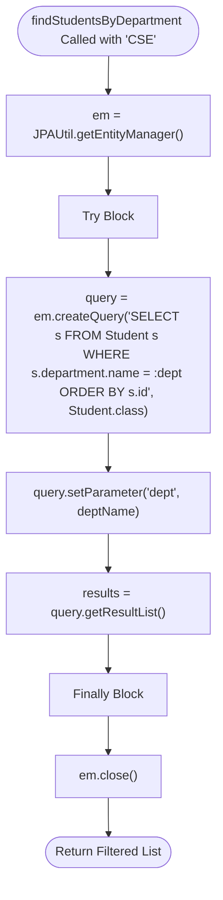

### 5.7 `searchByName(String name)` & `getStudentCount()`
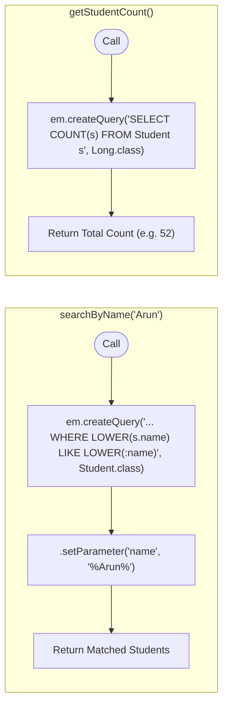

---

## 👔 6. `StudentService.java` Method Delegation

* **Real-World Use Case:** Centralized business coordinator. Whether requests come with raw IDs/Strings (from older forms) or entity objects, the service resolves dependencies and delegates to DAOs cleanly.

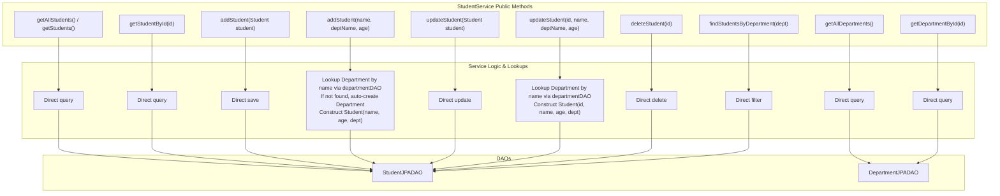

---

## 🛎️ 7. `StudentServlet.java` Controller Flowcharts

### 7.1 `doGet(request, response)` — Handling Page Loads & Actions
* **Real-World Use Case:** Browser navigation, showing lists, filtering by department, opening edit forms, or deleting records.

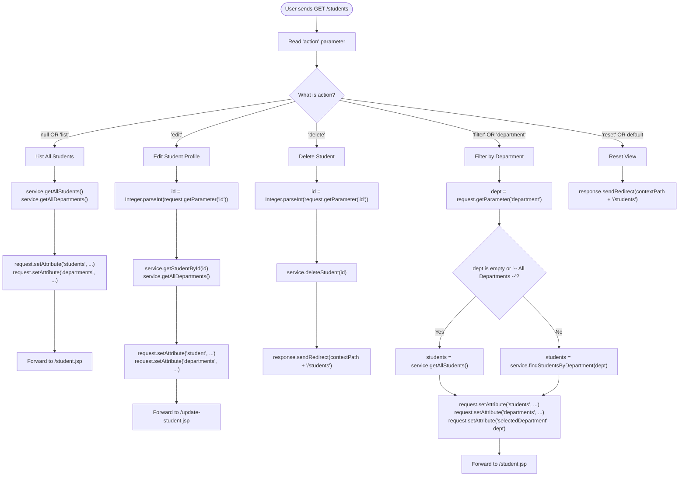

---

### 7.2 `doPost(request, response)` — Handling Form Submissions
* **Real-World Use Case:** Submitting the "Add Student" form or submitting changes on the "Edit Student" form.

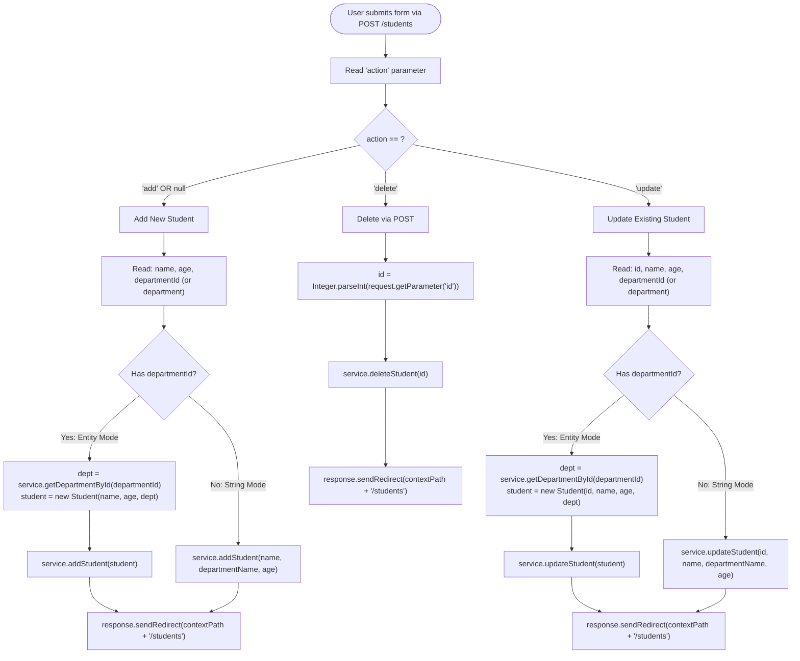

---

## 🎨 8. User Interaction Flows (JSP & Web Pages)

### 8.1 Filter & Reset Interaction Flow
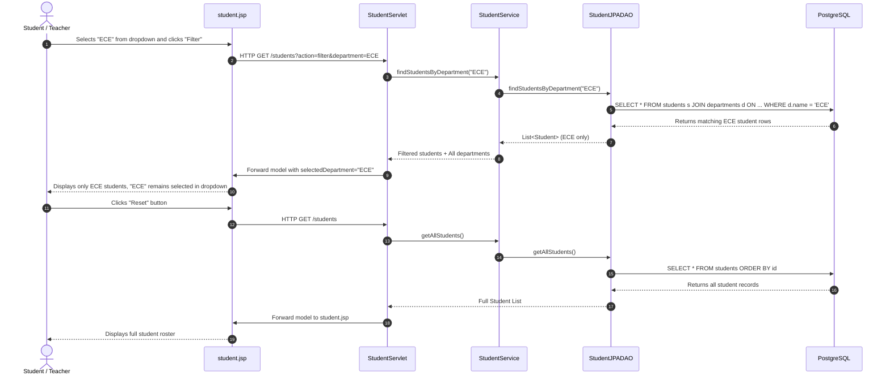

---

### 8.2 Edit & Update Student Interaction Flow
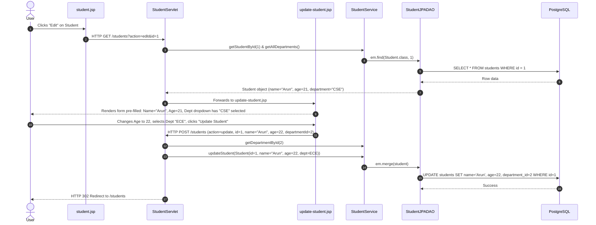

---

## 💡 9. Summary Quick Reference for Classroom Teaching

| Classroom Question | Simple Answer |
| :--- | :--- |
| **Why did we switch from Day 8 to Day 10?** | In Day 8 (JDBC), we manually wrote raw SQL strings, manually extracted columns from `ResultSet`, and handled connections by hand. In Day 10 (JPA/Hibernate), we work with pure Java objects, and Hibernate generates the SQL automatically. |
| **Why is `@ManyToOne` on Student instead of Department?** | Because the foreign key column (`department_id`) is physically in the `students` table. The table holding the foreign key is always the **owning side** in JPA. |
| **What does `mappedBy="department"` in Department mean?** | It tells Hibernate: *"I am the inverse side. Look at the `department` field inside `Student.java` to find the foreign key mapping."* |
| **Why do we need `em.getTransaction().begin()` for adding/updating/deleting, but not for finding?** | Reading data does not alter the database state (it's safe and read-only). Any operation that changes data (`persist`, `merge`, `remove`) must be atomic inside a transaction so it can rollback if an error occurs. |
| **Why use `${pageContext.request.contextPath}/students` in forms?** | It ensures every link and form submission resolves to the exact root application path, preventing `404 Not Found` errors caused by relative URLs when query parameters or slashes change. |
